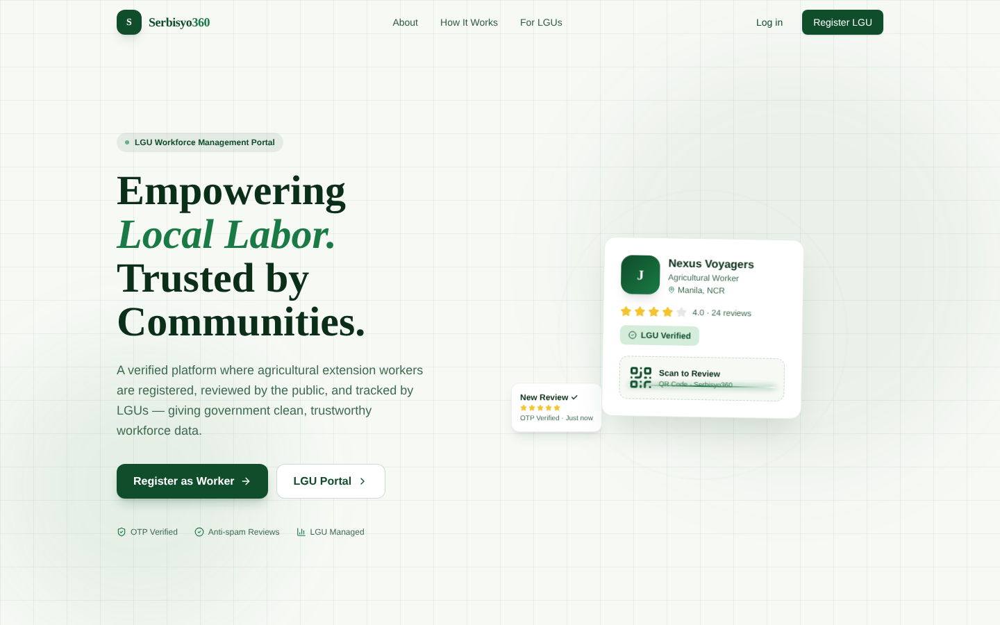
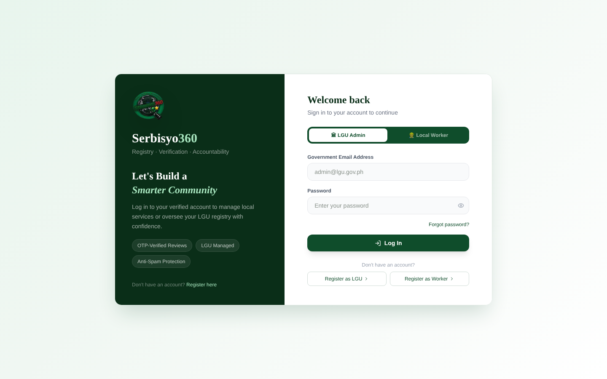
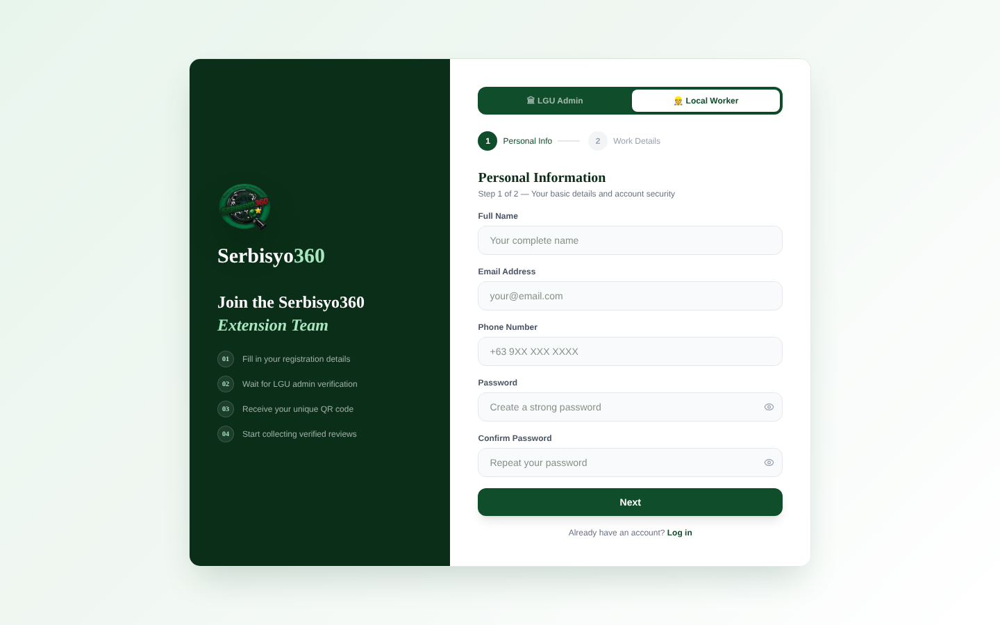

# Serbisyo360

**Registry · Verification · Accountability**

An LGU-managed platform for registering, verifying, and reviewing agricultural extension workers in the Philippines. Serbisyo360 helps Local Government Units maintain reliable workforce records and make informed decisions about worker deployment and management.

## Project Overview

Serbisyo360 is a civic-tech platform designed to improve the registration, verification, and monitoring of agricultural extension workers.

It provides a centralized platform where LGU administrators can manage worker records, extension workers can maintain their profiles, and community members can submit feedback through QR code-based profiles.

The current implementation focuses on the frontend. Data is mocked, and backend services such as authentication, database operations, SMS OTP verification, and QR code generation are not yet connected.

## Screenshots

### Landing Page


### Login


### Worker Registration


## Features

- **Worker Registration** – Registration for agricultural extension workers and LGU administrators.
- **Profile Verification** – LGU administrators can review, approve, reject, and deactivate worker profiles.
- **QR Code Profiles** – Verified workers have a public profile accessible through a QR code.
- **Community Reviews** – Community members can submit ratings and feedback without creating an account.
- **SMS OTP Verification** – Phone verification through Semaphore PH to help prevent duplicate and spam reviews.
- **Worker Dashboard** – Workers can view their profiles, ratings, and community reviews.
- **LGU Dashboard** – Administrators can manage workers, review registrations, and view workforce statistics and analytics.

### User Roles

| Role | Description |
|---|---|
| LGU Admin | Manages worker registrations, verification, and workforce records. |
| Extension Worker | Registers, manages their profile, and views ratings and reviews. |
| General Public | Scans worker QR codes and submits reviews without an account. |

## Tech Stack

| Technology | Purpose |
|---|---|
| Next.js 15 | React framework and App Router |
| TypeScript | Type safety |
| Tailwind CSS 4 | Styling |
| shadcn/ui | UI components |
| lucide-react | Icons |
| React Hook Form | Form management |
| Zod | Form validation |
| PostgreSQL | Database |
| Semaphore PH | SMS OTP delivery |

## Installation and Setup

### Prerequisites

- Node.js 18.17 or higher
- npm 9 or higher
- Git

### 1. Clone the repository

```bash
git clone https://github.com/frncsrys/Nexus-Voyagers---Serbisyo-360.git
cd Nexus-Voyagers---Serbisyo-360
```

### 2. Install dependencies

```bash
npm install
```

### 3. Run the development server

```bash
npm run dev
```

Open [http://localhost:3000](http://localhost:3000) in your browser.

---

## Team

**Nexus Voyagers**

Developed by Nexus Voyagers.
